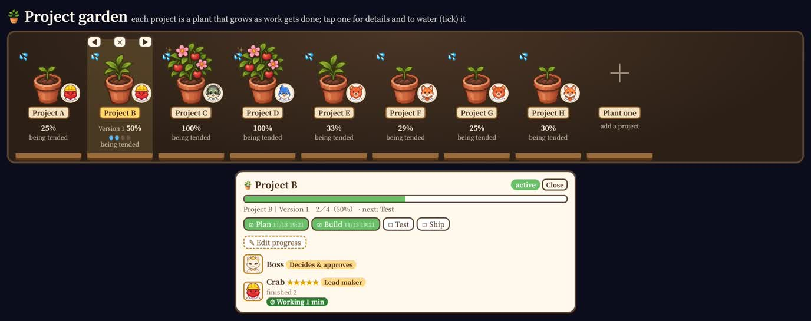
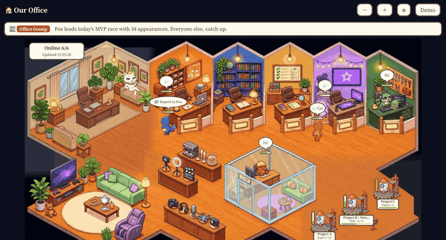
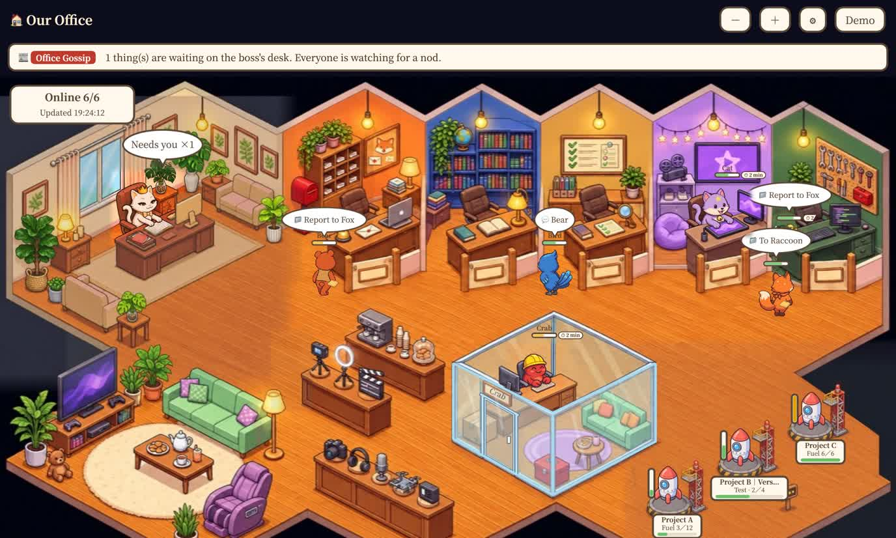
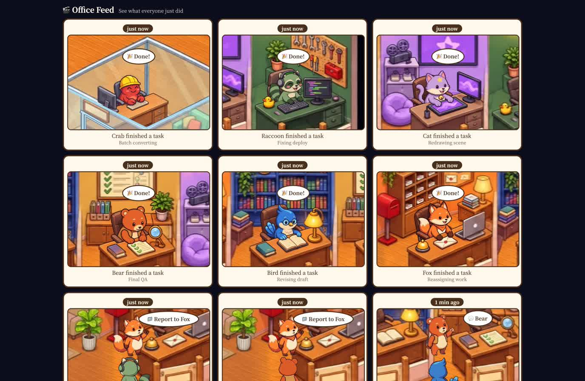

[繁體中文](README.md) | English

# Visual Office

A small pixel-art office in a web page that doubles as a light, friendly **project manager**: each of your AIs is a little animal, you are the boss, and one glance tells you who is busy, who is stuck, how far each project has come and what comes next.

## Project management

Your AI team's progress lives right in the office, no separate tool needed:

- 🪴 **Project garden**: every project is a potted plant that grows with progress (seed → sprout → leaves → buds → fruit). See all projects at a glance, with the lead animal standing by each pot.
- ☑️ **Stage checklists**: give each project stages (say Plan → Build → Test → Ship). AIs tick them off as they report; you can adjust by hand. Shows percent done, the next step and when each step was finished.
- 💡 **Suggested stages**: ready-made stages by project type (video, website, social posts, documents, courses…), one tap to apply and edit.
- 🚀 **Milestones**: each finished round (an episode, a version, a week, a post…) sends everyone to the lounge for a toast while the boss lights the rocket; the Office Feed keeps the record.
- 👥 **Roles and contribution**: who is on which project, in which role (coordinator, lead maker, support), with contribution stars.
- 🚨 **Spot problems early**: going in circles, slacking, vanishing without notice and working too long get flagged.
- ➕ **Keep it tidy**: "Plant one" to add a project, reorder, and put away the ones you don't need.



## Preview







## What it acts out

The core idea: everything an AI does has a human-like action. If you can't see it, it didn't happen.

| What is really going on | What you see |
|---|---|
| Online, work going well | Typing at their desk, smiling, rosy cheeks |
| Heavy workload, near the limit | Hunched over, sweating |
| Nothing to do | Off to the lounge: drinks, cookies, TV, the sofa |
| Offline | Empty seat with an "Out" sign |
| Out of quota | K.O. on the floor, seeing stars |
| Task failed | Swearing ＊@∆×, pounding the desk, slumped over the desk |
| Here, but not picking up messages | Turns semi-transparent with a ghost tail and a "Busy!" sign |
| Can't reach someone | Walks to their door, paces back and forth, knocks, question mark |
| Several sessions open at once | Semi-transparent clones behind them, labelled "×4" |
| Assigning work, reporting back | Walks over carrying a folder: "📁 To B" or "📁 Report to B" |
| Things waiting for you | Folders on your desk, one per item |
| A sandboxed AI needs someone | A call light outside the wall turns on and the called one walks to the door |
| Glass room as a meeting room (pick "Meeting room" in ⚙︎) | Two AIs who talk walk into the glass room together; the door sign reads "Meeting"; one pair at a time, and the glass-room AI is hidden when unused |

Below the live view there is also:

- **Office Feed**: nine small shots, each one something that just happened. Click one to see it enlarged and re-enacted.
- **Office Gossip**: a banner above the scene that turns the most dramatic thing happening right now into one line.
- **Rocket launch site**: always three pads at the bottom right. In ⚙︎, pick which projects sit on them and how progress counts (one rocket per round, per accepted post, one checklist, manual, automatic). When a round is done, everyone toasts in the lounge, the boss walks to the pad and lights the fuse, and the rocket lifts off and hovers over its pad until the next one launches.
- **Project garden**: each project is a potted plant that grows with progress (seed → sprout → leaves → buds → fruit), with the animal tending it beside the pot. "＋ Plant one" adds a project by hand. Tap a pot for details: who is on each project, in which role, how long since it moved and how far along, with marks for going in circles, slacking and vanishing. Reorder cards with ▲▼, hide them with ✕ (bring them back at the bottom), and "Set up progress" to get suggested stages you tick right on the card, with percent done, the next step and when each box was ticked.
- **Today's MVP Race**: ranking by how often each AI appeared that day; first place gets a certificate of praise.
- The ⚙︎ button lets you pick an animal for each AI and hide the ones you don't use.

The full design rationale is in [docs/design-and-workflow.en.md](docs/design-and-workflow.en.md).

## Start in three steps

1. Have Python 3. Only the standard library is used, nothing to install.
2. In this folder, run:

   ```
   python3 server.py
   ```

3. Open <http://127.0.0.1:8765> in your browser.

It starts in **demo mode**: nothing to connect, the characters act out a whole day on their own.

To change the port: `python3 server.py --port 9000`, or change `port` in `office.config.json`.

## Language

Traditional Chinese and English are built in. Add `?lang=en` to the URL (for example `http://127.0.0.1:8765/?lang=en`), or set `"lang": "en"` in `office.config.json`. The server also accepts `python3 server.py --lang en`, which switches the demo text as well. Without any of these, the page follows your browser language.

## Connect Claude Code (one line)

```
python3 integrations/claude-code/install.py
```

Start a new Claude Code session and it reports by itself: it sits down to work when you send a prompt, gets up when the turn ends, and goes home after 10 quiet minutes. The bear stands for it by default; add `--id fox` to change (fox, bird, bear, cat, raccoon, crab), or `--remove` to undo.

- It sends only which character, busy or not, and the working folder's name. Never your prompt or the conversation.
- The installer adds four hooks to `~/.claude/settings.json`, writes a backup first, and keeps your existing hooks.
- Set `"demo": false` in `office.config.json` and start the server first.
- Several sessions at once share one animal; the last report wins.

For other tools, see the next section.

## Connect your own AIs

1. Set `"demo"` to `false` in `office.config.json` and restart the server.
2. Have your AIs report their status over HTTP, for example:

   ```
   curl -X POST http://127.0.0.1:8765/update \
     -H 'X-Office: 1' -H 'Content-Type: application/json' \
     -d '{"id": "fox", "online": true, "busy": true, "doing": "整理週報"}'
   ```

A character that hasn't reported for more than 10 minutes counts as offline (except the boss).

Full API, more examples and common setups: [docs/connect-your-ai.en.md](docs/connect-your-ai.en.md).

## Use your own character names

Edit `cast` in `office.config.json`:

```json
"cast": {
  "fox":  {"name": "小狐", "role": "總協調，派工給大家"},
  "bird": {"name": "阿鳥", "role": "研究、寫作"}
}
```

The seven character ids are fixed: `boss`, `fox`, `bird`, `bear`, `cat`, `raccoon`, `crab`. You change the displayed name and role, not the animal itself. `boss` is you. Characters you don't need can be hidden with `"hidden": true`.

When the page is in English and a name or role is still the stock Chinese default, the page shows an English default (Fox, Bird, ...). Any name you set yourself is always shown as you wrote it.

## FAQ

**Is each animal tied to a specific AI?**
No. The seven animals' looks and seats are fixed, but who is who is up to you: change the names and roles in `cast` in `office.config.json` to your AIs. Have each AI report with the matching id (for example, if you make `bird` your research assistant, it reports with `"id": "bird"`).

**How do I show project progress?**
Send a project name with your reports (the `tag` in `/talk`) and a card for that project appears on the Projects wall: who is on it, in which role, and how long since it last moved. For a progress bar, also report the steps done:

```
curl -X POST http://127.0.0.1:8765/project \
  -H 'X-Office: 1' -H 'Content-Type: application/json' \
  -d '{"name": "Website redesign", "done": 3, "total": 8}'
```

Once a card has stages (Projects → "Set up progress"), an AI can tick them too; ticking the last one starts the party and the launch:

```
curl -X POST http://127.0.0.1:8765/project \
  -H 'X-Office: 1' -H 'Content-Type: application/json' \
  -d '{"name": "Website redesign", "stage": "Test"}'
```

Launch-pad and wall settings live in `launchpad.json` and `wall.json` (ignored by git).

**Can I choose which animal stands for which AI?**
Yes. Click ⚙︎ in the top right, pick an animal for each AI, and hide the ones you don't need. Each animal comes with its room; the choice is saved in this device's browser only.

**I don't have that many AIs. What about the empty seats?**
Hide the characters you don't use in `cast`. They won't appear and won't count toward the online total:

```json
"cast": { "crab": {"hidden": true}, "raccoon": {"hidden": true} }
```

**I have more than six AIs. What now?**
The picture only has six AI desks (plus yours). Two options:

- Merge similar AIs into one animal. For example, have three coding sessions all report as `bear` and set `busy_n` to `3`; semi-transparent clones appear behind it, labelled "×3".
- If you really need more seats, you have to redraw the background, add character art, and change the seat coordinates in `index.html`. See "Make your own version" below.

**Everyone is away when I open it?**
Once demo mode is off, a character that has never reported is offline. Send one `/update` as in the examples in [docs/connect-your-ai.en.md](docs/connect-your-ai.en.md) and it walks in. If it doesn't report again for more than 10 minutes, it counts as offline again.

**How do I view it on my phone?**
By default only this computer can open it (`"bind": ["127.0.0.1"]`). To let a phone on the same network see it, add the computer's local network address to `bind`, then open `http://that-address:8765` on the phone. There is no login protection, so only add private network addresses and never expose it to the public internet.

**The port is taken and it won't open?**
Use another one: `python3 server.py --port 8800`, or change `port` in the config file.

**Does it work on Windows?**
It only uses the Python 3 standard library and no system-specific commands, so it should (use `python server.py`); the author has only run it on macOS.

**Does it send my conversations anywhere?**
No. The server makes no outside connections and only receives what your AIs report themselves: who, status, and a one-line description. `doing` and `tag` are shown on screen, so don't put anything confidential in them.

**Can I change how the boss looks, or the art style?**
Yes, but you need to provide the art: each character in `art/角色/` has a character sheet, walking frames and sitting frames, and `art/seat_*.jpg` is the "sitting at the desk" view. The art specs are in [docs/design-and-workflow.en.md](docs/design-and-workflow.en.md).

**Can the on-screen text be in another language?**
Traditional Chinese and English are built in. Add `?lang=en` to the URL, or set `"lang": "en"` in `office.config.json`.

## Make your own version

Changing the background, the animals, or the number of characters all requires changing the seat and walkway coordinates in `index.html`.

Suggested approach: give the whole of [docs/design-and-workflow.en.md](docs/design-and-workflow.en.md) to your AI (for example Claude Code) and ask it to follow the method there. Section 8 has an opening message you can paste directly.

Checking tool: add `?tracks` to the URL (for example `http://127.0.0.1:8765/?tracks`) to draw walkways, seats and occlusion areas over the background, so you can see at a glance whether a route goes through a wall.

## Limitations

- The Office Feed is a re-enactment from the log, not a recording.
- Demo mode content is made up, not real data.
- Seats and walkways are currently written in `index.html` and not yet in a config file.
- No login protection. Only run it on your own computer or a private network, never directly on the public internet.
- The art was generated with AI image tools to this project's specifications.
- The page loads a CJK font (Noto Serif TC) from Google Fonts and falls back to system fonts offline. It contacts no other outside service.

## License

- Code: MIT, see [LICENSE](LICENSE).
- Images in `art/`: free to use and modify along with this project.
