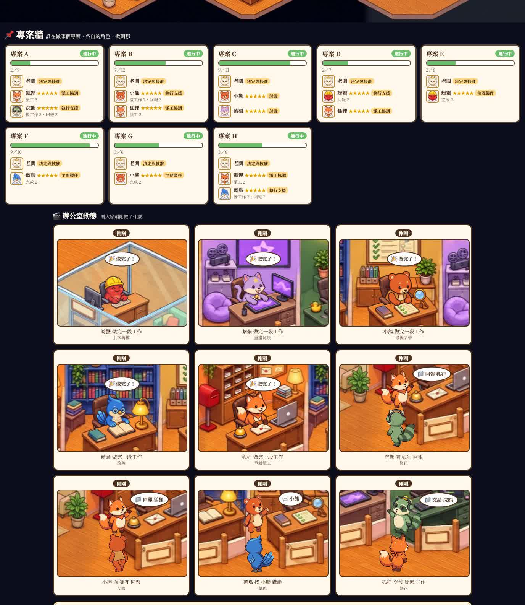

繁體中文 | [English](README.en.md)

# 可視化辦公室

一間像素風的小辦公室網頁：你的每個 AI 是一隻小動物，你是老闆，看一眼就知道誰在忙、誰閒著、誰卡住了。

**English.** Visual Office is a single web page that shows your AI assistants as small animals working in a cozy pixel-art office, with you as the boss. Each thing an AI does has a visible, human-like action: it collapses when its quota runs out, turns into a ghost when it ignores messages, and paces outside a door when it can't reach someone. A tiny Python server (standard library only) collects status over HTTP and the page redraws every few seconds. It ships with a demo mode, so you can see a whole day play out before connecting anything.

## 畫面預覽




## 它會演什麼

核心想法：AI 做的每一件事，都有一個擬人化的動作。看不到的事等於沒發生。

| 實際狀況 | 畫面上的樣子 |
|---|---|
| 在線、工作順利 | 坐在自己位子上打字，笑臉、臉頰紅潤 |
| 工作很重、快到極限 | 駝背、冒汗 |
| 沒事做 | 去休息區喝飲料、吃餅乾、看電視、躺沙發 |
| 不在線 | 座位空著，掛「外出中」牌 |
| 額度用完 | K.O. 倒地、眼冒金星 |
| 任務失敗 | 罵＊@∆×、捶桌、趴桌垂頭喪氣 |
| 人在，但訊息一直沒接 | 變半透明、下半身變鬼尾巴，掛「請勿打擾」 |
| 找不到人 | 走到對方門口來回踱步、敲門、冒問號 |
| 找人講話 | 走到對方辦公室入口，兩個人面對面；找你時會走進你的辦公室，你轉頭看他 |
| 忙了多久 | 頭上的小標籤「⏱ 12 分」，超過 20 分鐘變紅 |
| 同時開好幾個對話 | 身後多出半透明分身，旁邊標「×4」 |
| 派工、回報 | 拿著公文夾走過去，「📁 交給 B」或「📁 回報」 |
| 等你處理的事 | 你桌上的公文夾，一件一個 |
| 關在沙盒裡的 AI 要找人 | 牆外的呼叫燈亮起，被叫的人走到門外 |

即時畫面下方還有：

- **辦公室動態**：九格小鏡頭，每格是一件剛發生過的事，點開會放大重演。
- **八卦小報**：畫面上方一條橫幅，從目前狀態挑最有戲的一件事寫成一句話。
- **專案牆**：每個專案誰在做、各自的角色、多久沒動、做到哪，還會標出誰在鬼打牆、誰在摸魚、誰沒請假就消失。
- **今日 MVP 爭奪戰**：當天上榜次數的即時排名，半夜結算，第一名有表揚狀，隔天顯示「昨日 MVP」。
- 右上角 ⚙︎ 可以替每個 AI 挑一隻動物、把用不到的藏起來。

完整的設計邏輯在 [docs/設計邏輯與工作流.md](docs/設計邏輯與工作流.md)。

## 三步開始

1. 準備 Python 3。只用內建函式庫，不用安裝任何套件。
2. 在這個資料夾裡執行：

   ```
   python3 server.py
   ```

3. 瀏覽器打開 <http://127.0.0.1:8765>。

預設是**示範模式**：不用接任何東西，角色會自己演完一整天。

要換連接埠：`python3 server.py --port 9000`，或改 `office.config.json` 的 `port`。

## 接上 Claude Code（一行）

```
python3 integrations/claude-code/install.py
```

裝好後開一個新的 Claude Code 對話，它就會自動回報：送出指令時坐回位子工作、做完起身休息，10 分鐘沒動靜就下班。預設由小熊代表，要換就加 `--id fox`（可選 fox、bird、bear、cat、raccoon、crab）；要移除就加 `--remove`。

- 它只送出「哪個角色、忙不忙、所在資料夾的名字」，不送指令內容和對話。
- 安裝會在 `~/.claude/settings.json` 加四個 hook，動手前先備份，原有的 hook 不動。
- 記得先把 `office.config.json` 的 `"demo"` 改成 `false` 並啟動伺服器。
- 同時開好幾個對話時，它們共用同一隻動物，以最後回報的為準。

其他工具請看下一節。

## 接上自己的 AI

1. 把 `office.config.json` 裡的 `"demo"` 改成 `false`，重新啟動伺服器。
2. 讓你的 AI 用 HTTP 回報狀態，例如：

   ```
   curl -X POST http://127.0.0.1:8765/update \
     -H 'X-Office: 1' -H 'Content-Type: application/json' \
     -d '{"id": "fox", "online": true, "busy": true, "doing": "整理週報"}'
   ```

超過 10 分鐘沒回報的角色會被當成離線（老闆除外）。

完整介面、更多範例和常見接法：[docs/接上自己的AI.md](docs/接上自己的AI.md)。

## 換成自己的角色名字

改 `office.config.json` 的 `cast`：

```json
"cast": {
  "fox":  {"name": "小狐", "role": "總協調，派工給大家"},
  "bird": {"name": "阿鳥", "role": "研究、寫作"}
}
```

七個角色 id 是固定的：`boss`、`fox`、`bird`、`bear`、`cat`、`raccoon`、`crab`。你改的是顯示名稱和職責，不是動物本身。`boss` 是你自己。用不到的角色可以加 `"hidden": true` 隱藏。

## 常見問題

**哪隻動物是哪個 AI，是固定的嗎？**
不是。七隻動物的外型和座位是固定的，但「誰是誰」由你決定：在 `office.config.json` 的 `cast` 把名字和職責改成你的 AI 就好。讓你的 AI 回報時用對應的 id（例如你把 `bird` 設成你的研究助理，它就用 `"id": "bird"` 回報）。

**怎麼顯示專案進度？**
回報時帶上專案名（`/talk` 的 `tag`），專案牆就會出現那個專案的卡片：誰在做、各自的角色、多久沒動。要有進度條，再回報做完幾步：

```
curl -X POST http://127.0.0.1:8765/project \
  -H 'X-Office: 1' -H 'Content-Type: application/json' \
  -d '{"name": "網站改版", "done": 3, "total": 8}'
```

**可以換哪隻動物代表哪個 AI 嗎？**
可以。按右上角的 ⚙︎，替每個 AI 挑一隻動物，也可以把用不到的藏起來。動物和房間是一組的；設定只存在你這台裝置的瀏覽器裡。

**我的 AI 沒那麼多，空位怎麼辦？**
在 `cast` 裡把用不到的角色設成隱藏，牠就不會出現，在線人數也不會把牠算進去：

```json
"cast": { "crab": {"hidden": true}, "raccoon": {"hidden": true} }
```

**我的 AI 超過六個怎麼辦？**
畫面只有六張 AI 的桌子（加上你自己）。兩個做法：

- 把同類的 AI 併成一隻。例如三個寫程式的對話都用 `bear` 回報，並把 `busy_n` 設成 `3`，牠身後會多出半透明的分身、旁邊標「×3」。
- 真的要更多座位，就得重畫底圖、補角色圖，並改 `index.html` 的座位座標。做法見下面「想做自己的版本」。

**打開後所有人都不在位子上？**
示範模式關掉後，沒有回報過的角色就是離線。先照 [docs/接上自己的AI.md](docs/接上自己的AI.md) 的範例打一次 `/update`，牠就會走進來。超過 10 分鐘沒有再回報，會自動算離線。

**怎麼用手機看？**
預設只有這台電腦自己開得到（`"bind": ["127.0.0.1"]`）。要讓同一個網路的手機看，把電腦的區域網路位址加進 `bind`，再用手機開 `http://那個位址:8765`。這個程式沒有登入保護，請只加私人網路的位址，不要對公開網路開放。

**連接埠被占用、打不開？**
換一個：`python3 server.py --port 8800`，或改設定檔的 `port`。

**Windows 可以用嗎？**
程式只用 Python 3 標準函式庫，沒有系統相依的指令，理論上可以（指令改成 `python server.py`）；作者只在 macOS 上實際跑過。

**會把我的對話內容傳出去嗎？**
不會。伺服器不連外，只收你的 AI 主動回報的「誰、狀態、一句說明」。`doing` 和 `tag` 會顯示在畫面上，機密內容不要寫進去。

**可以把老闆換成別的樣子、或換畫風嗎？**
可以，但要自己準備圖：`art/角色/` 裡每個角色有角色表、走路圖和坐姿圖，`art/seat_*.jpg` 是「坐在桌前」的樣子。換圖的規格寫在 [docs/設計邏輯與工作流.md](docs/設計邏輯與工作流.md)。

**畫面上的字可以改成別的語言嗎？**
內建繁體中文和英文。網址後面加 `?lang=en`（例如 `http://127.0.0.1:8765/?lang=en`），或在 `office.config.json` 設 `"lang": "en"`。

## 想做自己的版本

換底圖、換動物、加減角色，都需要改 `index.html` 裡的座位與走道座標。

建議做法：把 [docs/設計邏輯與工作流.md](docs/設計邏輯與工作流.md) 整份交給你的 AI（例如 Claude Code），請它照裡面的方法做。文件第八節有可以直接貼的開場白。

檢查小工具：網址後面加 `?tracks`（例如 `http://127.0.0.1:8765/?tracks`），會在底圖上畫出走道、座位和遮擋範圍，一眼看出路線有沒有穿牆。

## 限制

- 辦公室動態是依紀錄重演，不是錄影。
- 示範模式的內容是編的，不是真實資料。
- 座位與走道目前寫在 `index.html` 裡，還沒抽成設定檔。
- 沒有登入保護。請只在自己的電腦或私人網路上開，不要直接放到公開網路。
- 美術是用 AI 繪圖工具依本專案需求生成的。
- 網頁會從 Google Fonts 載入中文字型（思源宋體）；沒有網路時改用系統內建字型。除此之外不連任何外部服務。

## 授權

- 程式：MIT，見 [LICENSE](LICENSE)。
- `art/` 裡的圖：可隨本專案自由使用與修改。
